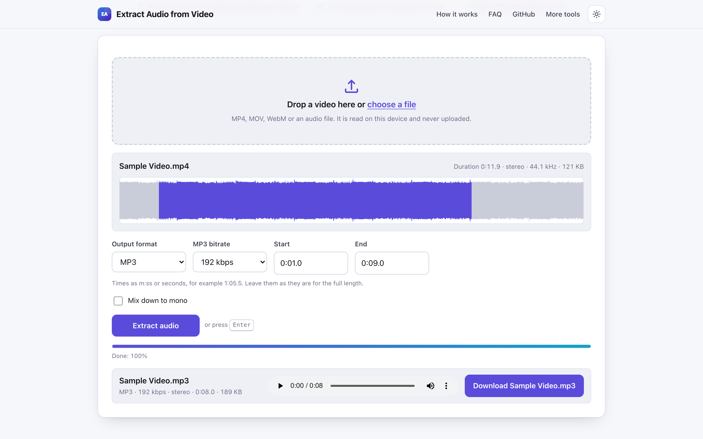
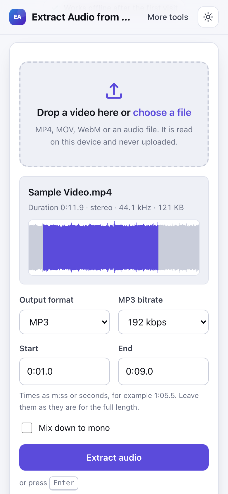

# Extract Audio from Video

> Pull the sound out of a video as MP3 or WAV in your browser, with nothing uploaded.

**🌐 Use it now: [turhe123.github.io/extract-audio-from-video](https://turhe123.github.io/extract-audio-from-video/)** · free · open source · runs in your browser · works offline


## Why

Extract Audio from Video is a free, open-source alternative to Online Audio Converter and Video to MP3 sites such as 123apps and CloudConvert, which upload your video to a server, cap file sizes, limit daily conversions and show ads. Here your files never leave the device, there is no account, no ads and no daily limit, it works offline, and you can install it as an app.

## Screenshots

<p align="center"></p>

<p align="center"><em>Extract Audio from Video in the browser, light theme</em></p>

<p align="center"></p>

<p align="center"><em>Extract Audio from Video on a phone</em></p>

## Features

- Load one video or audio file by dropping it on the page or choosing it. The file is read locally.
- Shows the file name, duration, channel layout, sample rate and size, plus a waveform of the audio track.
- Output as **MP3** (default) or **WAV** (lossless, 16-bit).
- MP3 bitrate of 96, 128, 192 (default), 256 or 320 kbps.
- Optional start and end times (`m:ss`, `h:mm:ss` or plain seconds, such as `1:05.5`) to extract only a portion. The waveform highlights the selected range.
- Optional mono downmix.
- Encoding runs in a Web Worker with a progress bar, so the page stays responsive.
- Result card with format, length and size, a built-in audio player to check the result, and a Download button. The output is named after the source file with the new extension; Unicode file names are kept.
- Clear inline errors for unsupported containers or codecs, videos with no audio track, and files that are too large for memory.
- Keyboard friendly: Enter starts extraction, Space plays or pauses the preview.
- Light and dark themes, layout that works at 390 px wide, installable and usable offline.

**Input:** whatever your browser can decode. MP4, MOV and M4A with AAC, and WebM or MKV with Opus or Vorbis, are the common cases; audio files (MP3, WAV, OGG, FLAC, AAC and others) are accepted too. If a file has several audio tracks, the default track is used.

**Output:** MP3 or WAV.

**Limits:** everything happens in browser memory.
- Files over about 1 GB show a warning; files over 2 GB are refused.
- Decoded audio takes roughly 600 MB per hour of stereo, so media longer than 2 hours (1 hour on iPhone and iPad) is refused. Trim it first.
- If the browser can play a file but cannot decode its sound codec, the tool says so; try another browser.
- For surround sound, the front left and right channels are used when not mixing down to mono.

## How to use

1. Drop a video (or audio file) on the page, or choose it. The waveform and duration appear.
2. Pick MP3 or WAV. For MP3, choose a bitrate.
3. Optionally set a start and end time, or tick "Mix down to mono".
4. Press **Extract audio** (or Enter) and wait for the progress bar.
5. Listen to the preview, then press the Download button.

## Privacy

- Nothing is uploaded. Your file is decoded and encoded on your device with browser APIs and JavaScript.
- No cookies and no account.
- Page views are counted anonymously with [GoatCounter](https://www.goatcounter.com/), which is cookieless and open source. No file data is ever part of that request.
- A service worker caches the page after the first visit, so it works offline.

## Run it locally

```sh
git clone https://github.com/turhe123/extract-audio-from-video
cd extract-audio-from-video
python3 -m http.server 4173
```

Then open http://127.0.0.1:4173/. There is no build step.

## Tests

```sh
npm i -D @playwright/test && npx playwright install chromium
npx playwright test
```

## Third-party code

| Library | Version | License | Used for |
| --- | --- | --- | --- |
| [lamejs](https://github.com/zhuker/lamejs) (in `vendor/lamejs/`) | 1.2.1 | LGPL-3.0 | MP3 encoding |

## Built with AI

Extract Audio from Video was written by [Claude Code](https://claude.com/claude-code) inside an automated pipeline, from a plain-English spec. No code or assets from any commercial product were used; it is a clean-room implementation of a feature set, not a copy.

What that means in practice:

- The full source is in this repo under the MIT license. Read it before you trust it with your files.
- Everything runs in your browser. It makes no network requests except an anonymous, cookieless page-view count (GoatCounter); your files never leave the device.
- The page is tested headless in Chromium (Playwright) before every release, but it has had less human review than hand-written software. Bug reports and pull requests are welcome.

## Support ❤️

If this saved you a trip to a paid converter, you can say thanks on [Ko-fi](https://ko-fi.com/leodavidai).

## More free web tools

Find more at [turhe123.github.io/web-tools](https://turhe123.github.io/web-tools/).

## License

MIT © Or Davidai Bachar
